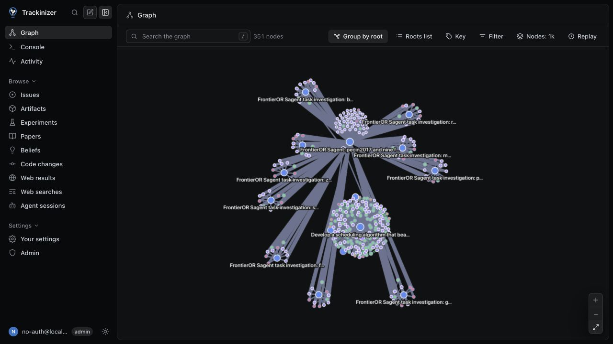
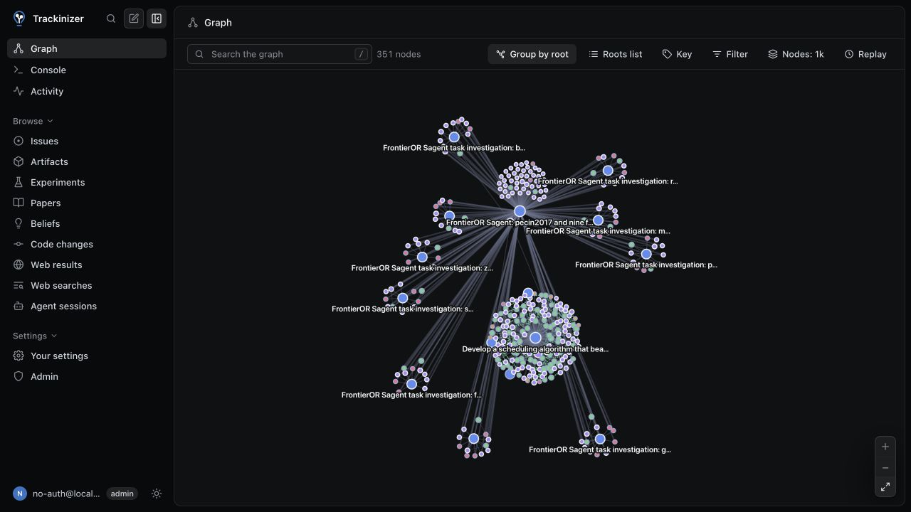

# Graph connection contrast

Real browser captures of the same saved FrontierOR graph, before and after changing connection width and opacity. The dataset contains 351 records and 608 relationships. API responses from both previews matched exactly.

## Setup

Before: unchanged upstream `abfa8d072f98073e627c7d5f2c96d80b8b2a0759`.
After: the same revision with only `drawLink` changed in `trackinizer/web/src/graph/renderer.ts`.

Both frontends used the same backend and saved database through read-only local previews. No records or relationships were edited. The captures use a 1280 × 720 viewport, the same grouped layout, no filters or focus, closed Roots and Key panels, and Fit after settling. No nodes were manually moved. Light-theme captures change only the theme after the dark captures. Images are unedited screenshots of the running app.

## Dark theme

| Before | After |
| --- | --- |
|  |  |

## Light theme

| Before | After |
| --- | --- |
|  |  |

## Scope

Connection strokes use 40% of the existing width, preserving relative weight differences. `produced_by` strokes use 35% opacity; other strokes keep full opacity. Canvas state is restored after drawing each line. Colours, dash patterns, arrowheads, labels, node sizing, layout forces and selection behavior retain their upstream implementation.

These captures show appearance, not a performance benchmark or proof that research decisions improve. Large graphs can still be dense, and labels can still overlap or truncate.

## Validation

Checked on macOS against upstream `abfa8d0`:

- Frontend graph tests: 146 passed, one skipped. No tests were changed for this styling-only patch.
- Frontend TypeScript check and production build passed.
- Ruff check, Ruff format check, import check and Python package build passed.
- Changed renderer and this README passed codespell; `git diff --check` passed.
- Full Python suite: 8,649 passed, 19 failed, eight skipped, 1,681 deselected, nine errors. Failures were in worker-count and POSIX tests; the nine errors were in macOS vnode tests.
- `ty check` reported an `os.waitid` diagnostic in `trackinizer/lib/posix/pids_test.py`.
- `basedpyright trackinizer` reported eight errors and 1,726 warnings.
- Whole-repository codespell reported findings outside the changed files, including `thead` in existing TSX and words in generated API schemas.

## Untouched upstream comparison

The full Python suite and the failing type/spelling checks were rerun on unchanged upstream `abfa8d0`, on the same Mac with Python 3.14.6 and the same dependency lockfile.

- Upstream: 8,646 passed, 22 failed, eight skipped, 1,681 deselected, nine errors.
- Every one of the PR run's 19 failed tests and nine teardown errors also occurred upstream. Upstream had three additional worker-count failures.
- `ty` reproduced the same `os.waitid` diagnostic. Basedpyright reproduced the same eight errors and 1,726 warnings.
- Codespell findings outside generated build output matched. Built asset filenames differ between frontend builds, so the whole codespell output is not byte-identical.

The worker-count tests supply fake memory values, but `_available_mib` prefers the host's `vm_stat` output on macOS. Available host memory therefore affects their results. The vnode teardown errors come from a test mock accepting one positional argument while Python's selector passes three. A process-liveness test assumes the Linux `/proc` path, while this Mac takes the `os.kill` fallback. The remaining FSEvents test's expected exception also fails upstream; its exact cause has not been isolated.

These checks do not establish a passing full suite, but they do establish that all failures reported from the PR run reproduce without the renderer change. No unrelated code was changed or tests skipped.

Prepared with AI assistance under the author's direction.
