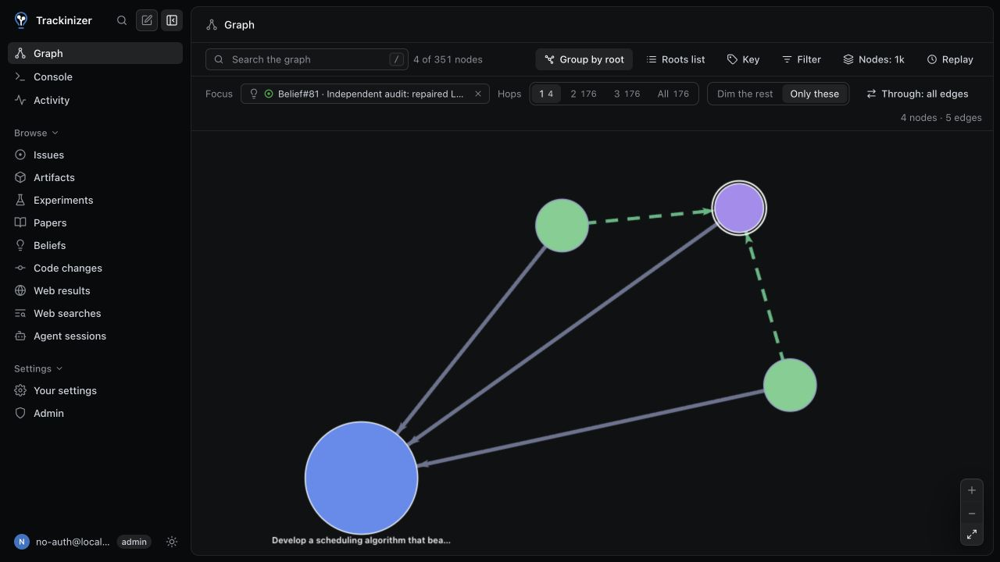
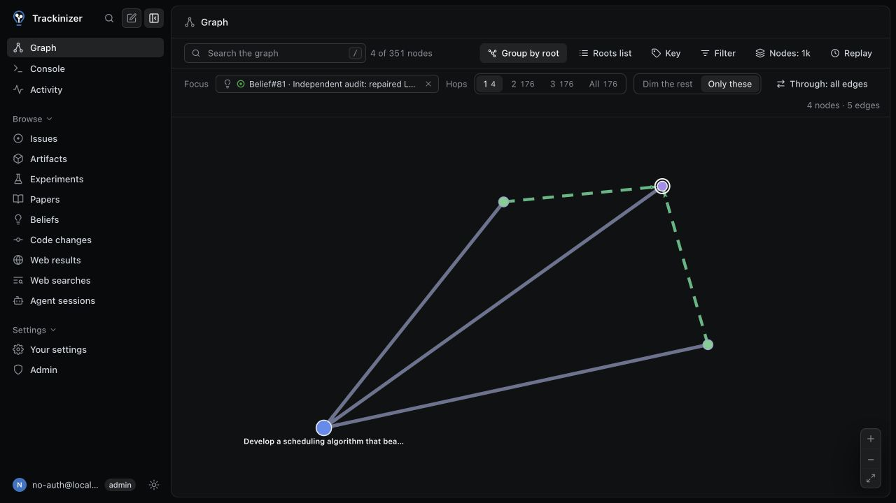
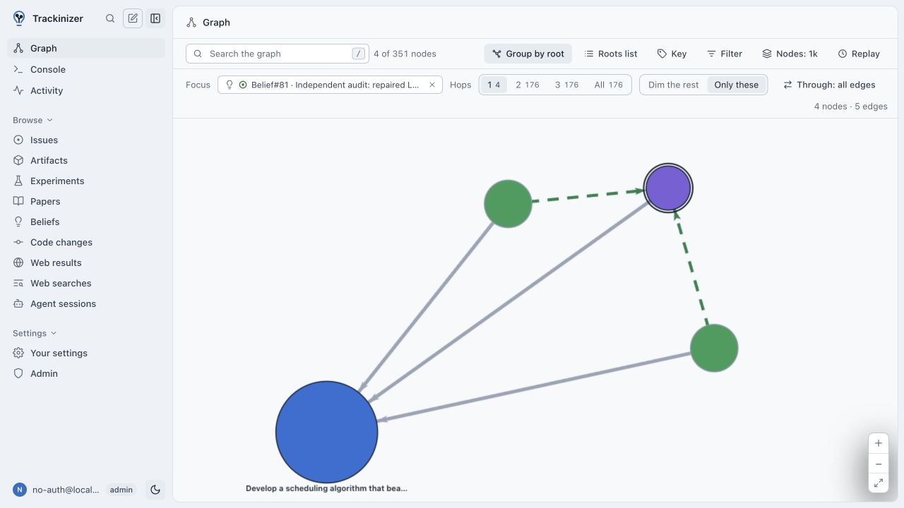
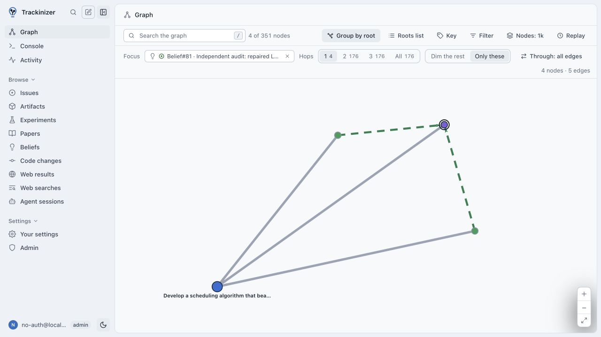

# Compact nodes when zooming

Real browser captures of the same saved FrontierOR graph, focused on Belief#81 and its one-hop neighborhood: four records and five relationships.

| Before | After |
| --- | --- |
|  |  |
|  |  |

## Setup

Before: unchanged upstream `abfa8d072f98073e627c7d5f2c96d80b8b2a0759`.
After: the same revision with the node-size change in `trackinizer/web/src/graph/renderer.ts`.

Both frontends used the same backend through read-only local previews. Their graph API responses matched exactly: 351 records and 608 relationships. No records were edited.

Captures use `/trax/graph?focus=Belief/81&hops=1`, a 1280 × 720 viewport, Group by root enabled, Only these selected, Roots list and Key closed, and Fit after settling. No nodes were manually moved. Light captures change only the theme. Images are unedited screenshots.

## Scope

Root nodes stop growing at an 11-pixel radius; other nodes stop at seven pixels. Existing degree-based sizing remains below those caps. Halos, status dots, arrow endpoints and the existing label offset follow the displayed radius. Hit targets cover the visible node, allowing an eight-pixel radius for smaller nodes. Arrowheads stop growing at ten pixels.

Connection strokes, layout forces and label content retain their upstream implementation. This change does not include the separate connection-line cleanup.

## Validation

- Graph tests: 148 passed, one skipped, including radius, halo, status-dot, arrow and hit-target checks at four zoom levels.
- TypeScript check and frontend production build passed.
- Browser checks in dark and light themes: clicking Experiment#36 opened its real details; clicking outside its smaller target did not. No browser console errors were recorded.
- Ruff check, Ruff format check, Python import and package build passed.
- Changed files passed codespell and `git diff --check`.

The full Python suite on this Mac reported 8,649 passed, 19 failed, eight skipped, 1,681 deselected and nine errors. Every failed test and teardown error also occurred on unchanged upstream `abfa8d0`, using the same Python 3.14.6 environment and dependency lockfile. That upstream run reported 8,646 passed, 22 failed and nine errors. The additional upstream failures were worker-count tests affected by available host memory.

The remaining repository checks also have upstream findings: `ty` reports an `os.waitid` diagnostic, `basedpyright` reports eight errors and 1,726 warnings, and whole-repository codespell reports findings outside these changes. No Python code or test exclusions were changed.

Prepared with AI assistance under the author's direction.
